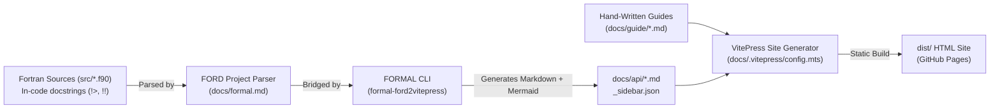

# Modern Fortran Documentation Workflow (FORD + FORMAL + VitePress)

This skill provides the standard workflow and best practices for creating and maintaining documentation in modern Fortran projects, following the architecture established by **Stefano Zaghi** (author of FoBiS, FLAP, FOSSIL, and FORMAL).

---

## 1. Architecture Overview: The Two-Tier Strategy

A robust Fortran documentation system separates automated API reflection from user-centric storytelling:



1. **Tier 1 — Source Code API Reflection (FORD)**:
   - Resides directly inside `.f90` files adjacent to code.
   - Focuses strictly on types, interfaces, argument intents, pre/post-conditions, and algorithmic complexity.
   - FORD parses the Fortran AST without requiring manual duplication.
2. **Tier 2 — User Experience & Guides (FORMAL + VitePress)**:
   - `formal generate` translates the parsed FORD project into VitePress-native Markdown pages in `docs/api/`, automatically embedding interactive Mermaid dependency and inheritance diagrams.
   - Hand-authored guides (`docs/guide/`) provide tutorials, decision flowcharts, architectural overviews, and benchmarks.
   - VitePress compiles everything into an ultra-fast, searchable, responsive static website with full LaTeX math and Mermaid support.

---

## 2. In-Code Fortran Docstrings (FORD Standards)

### Rule A: Comment Markers
In FORD with standard configuration (`predocmark: >` and `docmark: !`):
- **Preceding comments (`!>`)**: Must precede the entity being documented on a separate line.
- **Inline / Following comments (`!!`)**: Must follow the entity on the same line.
- **Never put `!>` or `!<` inline on the same line as code**; FORD's reader will fail with `"Preceding documentation lines can not be inline"`.

### Example Module Header
```fortran
!> # Module datastructs_samplers_btree_mod
!>
!> Binary tree weighted sampler for continuous-time stochastic processes.
!>
!> Maintains a complete binary tree where each node stores the partial sum
!> of weights in its subtree, providing deterministic $O(\log N)$ updates.
!>
!> ### Algorithmic Complexity:
!> - **Sampling**: $O(\log N)$ via top-down binary search.
!> - **Weight update**: $O(\log N)$ via bottom-up tree propagation.
!> - **Memory**: $O(N)$ with internal storage of $2^{\lceil \log_2 N \rceil + 1}$ nodes.
module datastructs_samplers_btree_mod
    use datastructs_kinds_mod
    implicit none
    private
```

### Example Derived Type & Methods
```fortran
    !> Derived type implementing the binary tree sampler
    type, extends(sampler_base_t) :: weighted_sampler_t
        real(kind=dp), allocatable :: tree(:) !! Internal binary tree storing partial subtree sums
        integer(kind=i4)           :: n_leaves = 0 !! Number of active leaves
    contains
        procedure :: init       => btree_init       !! Initialize tree with capacity N
        procedure :: set_weight => btree_set_weight !! Set weight at index in O(log N)
        procedure :: sample     => btree_sample     !! Sample index proportional to weight
        final     :: btree_finalize                 !! Deallocate heap memory
    end type weighted_sampler_t
```

### Example Routine Documentation
```fortran
    !> Updates the weight assigned to a specific element index.
    !> Propagates the weight delta up to the tree root in $O(\log N)$ time.
    subroutine btree_set_weight(this, index, weight)
        class(weighted_sampler_t), intent(inout) :: this   !! Sampler instance
        integer(kind=i4), intent(in)             :: index  !! 1-based element index (1..n)
        real(kind=dp), intent(in)                :: weight !! New weight value (>= 0.0)
```

### LaTeX Math Best Practices in Fortran Docstrings
Always use standard MathJax delimiters:
- **Inline Math**: `$x = 1$` or `$O(\log N)$`.
- **Block Math**:
  ```fortran
  !> $$
  !> P(i) = \frac{w_i}{\sum_j w_j}
  !> $$
  ```

---

## 3. The FORMAL Project File (`docs/formal.md`)

Create `docs/formal.md` (or `docs/ford.md`) as the configuration file parsed by FORMAL:

```yaml
---
project: my-fortran-project
summary: High performance scientific computing in Fortran
version: 1.0.0
author: Jane Doe
project_github: https://github.com/my-user/my-fortran-project
github: https://github.com/my-user
src_dir: ../src
predocmark: >
docmark: !
display: public
         protected
source: true
graph: true
preprocessor: gfortran -E
---

{!../README.md!}
```

---

## 4. VitePress Configuration (`docs/.vitepress/config.mts`)

To guarantee that **both LaTeX and Mermaid** render seamlessly in VitePress without build errors (following FLAP's proven setup):

```typescript
import { withMermaid } from 'vitepress-plugin-mermaid'
import fs from 'node:fs'
import path from 'node:path'
import apiSidebar from '../api/_sidebar.json'

const base = process.env.BASE_PATH || '/my-fortran-project/'

// Read current project version dynamically from fpm.toml
let version = 'latest'
try {
  const fpmPath = path.resolve(__dirname, '../../fpm.toml')
  const fpmContent = fs.readFileSync(fpmPath, 'utf-8')
  const match = fpmContent.match(/^version\s*=\s*"([^"]+)"/m)
  if (match) version = match[1]
} catch (e) {}

const guideSidebar = [
  {
    text: 'Start here',
    items: [
      { text: 'Introduction', link: '/guide/' },
      { text: 'Installation', link: '/guide/install' },
    ],
  },
  {
    text: 'Core Guides',
    items: [
      { text: 'Architecture & Design', link: '/guide/architecture' },
      { text: 'Algorithms & Usage',    link: '/guide/algorithms' },
    ],
  },
]

export default withMermaid({
  title: 'my-fortran-project',
  description: 'High performance scientific computing in Fortran',
  base: base,
  markdown: {
    math: true,
    languages: ['fortran-free-form', 'fortran-fixed-form'],
    languageAlias: {
      'fortran': 'fortran-free-form',
      'f90': 'fortran-free-form',
      'f95': 'fortran-free-form',
      'f03': 'fortran-free-form',
      'f08': 'fortran-free-form',
      'f77': 'fortran-fixed-form',
    },
    config(md) {
      const origRender = md.render.bind(md)
      md.render = (src, env) => {
        // Translate \( ... \) and \[ ... \] into standard MathJax delimiters
        const transformed = src
          .replace(/\\\[([\s\S]*?)\\\]/g, '\n$$\n$1\n$$\n')
          .replace(/\\\(([\s\S]*?)\\\)/g, '$$$1$$')
        return origRender(transformed, env)
      }
    },
  },
  themeConfig: {
    nav: [
      { text: 'Home', link: '/' },
      { text: 'Guide', link: '/guide/', activeMatch: '^/guide/' },
      { text: 'API Reference', link: '/api/', activeMatch: '^/api/' },
      {
        text: `v${version}`,
        items: [
          { text: 'Releases', link: 'https://github.com/my-user/my-fortran-project/releases' },
          { text: 'Tags', link: 'https://github.com/my-user/my-fortran-project/tags' },
        ],
      },
    ],
    sidebar: {
      '/guide/': guideSidebar,
      '/api/': [
        {
          text: 'API Reference',
          items: [{ text: 'Overview', link: '/api/' }],
        },
        ...apiSidebar,
      ],
    },
    socialLinks: [
      { icon: 'github', link: 'https://github.com/my-user/my-fortran-project' },
    ],
    search: {
      provider: 'local',
    },
  },
  mermaid: {},
  vite: {
    // Crucial: target es2022 prevents esbuild from failing on modern Mermaid syntax
    build: {
      target: 'es2022',
    },
  },
})
```

---

## 5. `docs/package.json`

```json
{
  "private": true,
  "scripts": {
    "docs:api": "formal generate --mirror-sources --diagrams --project formal.md --output api",
    "docs:dev": "vitepress dev",
    "docs:build": "vitepress build",
    "docs:preview": "vitepress preview"
  },
  "devDependencies": {
    "vitepress": "^1.6.3",
    "markdown-it-mathjax3": "^4.3.2",
    "vitepress-plugin-mermaid": "^2.0.17",
    "mermaid": "^11.15.0"
  },
  "overrides": {
    "esbuild": ">=0.25.0",
    "@xmldom/xmldom": ">=0.9.9"
  }
}
```

---

## 6. Directory Layout Reference

```
my-fortran-project/
├── .github/workflows/
│   └── docs.yml                  # GitHub Pages automated deployment
├── docs/
│   ├── .vitepress/
│   │   └── config.mts            # VitePress configuration
│   ├── api/                      # Auto-generated by FORMAL
│   │   ├── _sidebar.json
│   │   └── *.md
│   ├── guide/                    # Hand-written user guides
│   │   ├── index.md
│   │   ├── install.md
│   │   └── ...
│   ├── index.md                  # Landing home page
│   ├── formal.md                 # FORD configuration file
│   └── package.json              # Docs npm scripts & dependencies
├── src/                          # Fortran source files with !> and !! docstrings
├── fpm.toml
└── scripts/
    ├── build_docs.sh             # Convenience local build script
    └── release.py                # Release & version synchronization script
```

---

## 7. GitHub Actions Deployment Workflow (`.github/workflows/docs.yml`)

```yaml
name: Deploy docs

on:
  push:
    branches: [main]
  workflow_dispatch:

permissions:
  contents: read
  pages: write
  id-token: write

concurrency:
  group: pages
  cancel-in-progress: false

jobs:
  build:
    runs-on: ubuntu-latest
    steps:
      - uses: actions/checkout@v4

      - name: Set up Python
        uses: actions/setup-python@v5
        with:
          python-version: '3.12'

      - name: Install FORMAL
        run: pip install formal-ford2vitepress

      - name: Generate API markdown via FORMAL
        run: formal generate --diagrams --project docs/formal.md --output docs/api

      - uses: actions/setup-node@v4
        with:
          node-version: '20'

      - name: Install npm dependencies
        run: npm install
        working-directory: docs

      - name: Build VitePress site
        run: npm run docs:build
        working-directory: docs

      - uses: actions/upload-pages-artifact@v3
        with:
          path: docs/.vitepress/dist

  deploy:
    environment:
      name: github-pages
      url: ${{ steps.deployment.outputs.page_url }}
    needs: build
    runs-on: ubuntu-latest
    steps:
      - name: Deploy to GitHub Pages
        id: deployment
        uses: actions/deploy-pages@v4
```

---

## 8. Common Gotchas & Troubleshooting

1. **VitePress 404 on assets (`/assets/app.xxx.js` not found)**:
   - Ensure `base: '/repo-name/'` is specified in `docs/.vitepress/config.mts`.
   - Ensure `docs/.vitepress/config.mts` is **not** ignored in `.gitignore`. (Use `/.vitepress/` to ignore root temporary files rather than `.vitepress/`).
2. **Mermaid diagrams showing as raw code blocks**:
   - Ensure `vitepress-plugin-mermaid` is installed and the config uses `withMermaid({ ... })`.
   - Ensure `vite.build.target = 'es2022'` is configured in `config.mts`.
3. **LaTeX formulas showing as raw text**:
   - Ensure `markdown-it-mathjax3` is in `devDependencies` and `markdown: { math: true }` is enabled.
   - If using `\(...\)` syntax from FORD, include the regex pre-transform hook in `markdown.config(md)`.
4. **Version number out of sync**:
   - Read the version dynamically from `fpm.toml` in `config.mts` using `fs.readFileSync`.
   - Use `scripts/release.py` to synchronize `fpm.toml`, `ford.md`, `formal.md`, and `docs/index.md` on release.
