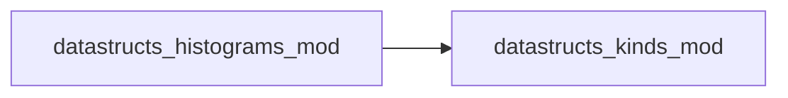

# datastructs_histograms_mod

> Module for weighted histograms with statistical operations.

 Provides a data structure to accumulate weighted values in bins and compute
 statistical properties such as mean, variance, and higher-order moments.

 Features:
 - Initialize and reset histograms with user-defined bin ranges
 - Add weighted values to bins
 - Compute mean, variance, and moments of any order

**Source**: `src/misc/histograms.f90`

**Dependencies**

## Contents

- [weighted_histogram_t](#weighted-histogram-t)

## Derived Types

### weighted_histogram_t

Weighted histogram type

#### Components

| Name | Type | Attributes | Description |
|------|------|------------|-------------|
| `bins` | real(kind=dp) | allocatable | Bin weights |
| `min_index` | integer(kind=i4) |  | Lower bound of bins |
| `max_index` | integer(kind=i4) |  | Upper bound of bins |
| `total_weight` | real(kind=dp) |  | Sum of all weights |

#### Type-Bound Procedures

| Name | Attributes | Description |
|------|------------|-------------|
| `init` |  |  |
| `reset` |  |  |
| `add_value` |  |  |
| `get_mean` |  |  |
| `get_variance` |  |  |
| `get_moment` |  |  |
