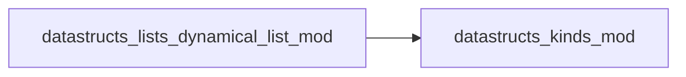

# datastructs_lists_dynamical_list_mod

> This module implements a dynamical list, in which elements can be added or removed dynamically.
 It assumes that there is a maximum size, and elements can be added or removed up to that size.
 Example:
 ```fortran
 program test_dynamical_list
     use datastructs_mod
     use datastructs_kinds_mod
     implicit none
     type(dynamical_list_t) :: my_list
     integer(kind=i4) :: i
     call my_list%init(10)
     do i = 1, 10
         call my_list%add(i)
     end do
     call my_list%print()
     call my_list%remove(5)
     call my_list%print()
 end program test_dynamical_list
 ```

**Source**: `src/lists/dynamical_list.f90`

**Dependencies**



## Contents

- [dynamical_list_t](#dynamical-list-t)
- [dynamical_list](#dynamical-list)

## Derived Types

### dynamical_list_t

List of integers with a given maximum fixed size
 The first index is always 1, and filled up to n_used
 It contains routines for managing the list

#### Components

| Name | Type | Attributes | Description |
|------|------|------------|-------------|
| `n` | integer(kind=i4) |  |  |
| `n_used` | integer(kind=i4) |  |  |
| `list` | integer(kind=i4) | allocatable |  |

#### Type-Bound Procedures

| Name | Attributes | Description |
|------|------------|-------------|
| `init` |  | Initialize list with maximum capacity |
| `reset` |  | Reset used elements count to 0 |
| `print` |  | Print list contents to stdout |
| `expand` |  | Expand capacity to a larger size |
| `trim` |  | Trim allocated memory to match n_used |
| `last` |  | Return the last added element |
| `count` |  | Count occurrences of a value |
| `add` |  | Add single element or array |
| `remove` |  | Remove element(s) by position, array of positions, or range |
| `assignment(=)` |  | Assign from integer array |
| `get` |  | Retrieve element value at 1-based position |
| `sum` |  | Sum of all active elements in list |

## Interfaces

### dynamical_list

Constructor for a dynamical list

**Module procedures**: `dynamical_list_new`
