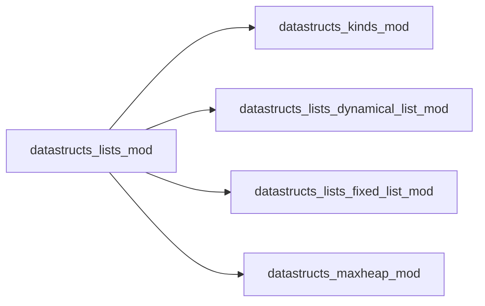
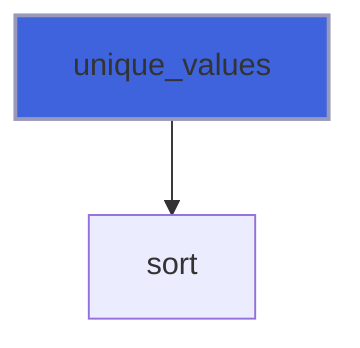

# datastructs_lists_mod

> General module for lists and related operations
 It imports the necessary modules for list and heap implementations

**Source**: `src/lists/lists.f90`

**Dependencies**



## Contents

- [unique_values](#unique-values)

## Functions

### unique_values

Find unique values in a list of integers.
 Uses internal high-performance Introsort to sort values in \(O(N \log N)\)
 before sequential deduplication.
 Returns a newly allocated array of unique integers in ascending order.

**Returns**: `integer(kind=i4)`

```fortran
function unique_values(list) result(unique)
```

**Arguments**

| Name | Type | Intent | Attributes | Description |
|------|------|--------|------------|-------------|
| `list` | integer(kind=i4) | in |  | Input list of integers |

**Call graph**


