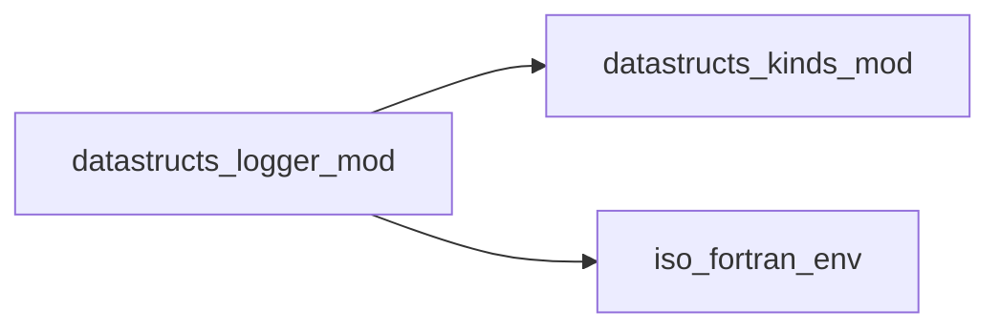

# datastructs_logger_mod

> Logging module for managing verbosity levels and output destinations.
 This module provides a simple logging system with support for different log
 levels (ERROR, WARNING, INFO, DEBUG), configurable verbosity, and output units.

 Features:
 - Enable or disable global verbosity
 - Control the log level threshold (e.g., show only ERROR, or include DEBUG)
 - Redirect logs to custom output units or reset to defaults (stdout/stderr)
 - Helper function to determine whether to log and which unit to use
 - Convenience subroutine to write logs directly

 @note
 This module is designed for modular use and can be applied to any program.
 @endnote

**Source**: `src/misc/logger.f90`

**Dependencies**



## Contents

- [log_write](#log-write)
- [set_verbose](#set-verbose)
- [set_level](#set-level)
- [set_output_unit](#set-output-unit)
- [set_error_unit](#set-error-unit)
- [set_unit_defaults](#set-unit-defaults)
- [log_unit](#log-unit)

## Variables

| Name | Type | Attributes | Description |
|------|------|------------|-------------|
| `LOG_ERROR` | integer | parameter | Error messages |
| `LOG_WARNING` | integer | parameter | Warning messages |
| `LOG_INFO` | integer | parameter | Informational messages |
| `LOG_DEBUG` | integer | parameter | Debug messages |
| `LOGGER_OK` | logical |  | Indicates if the last call to log_unit allowed logging |

## Interfaces

### log_write

**Module procedures**: `log_write_message`, `log_write_message_no_advance`, `log_write_message_i4`, `log_write_message_i4_no_advance`, `log_write_message_dp`, `log_write_message_dp_no_advance`

## Subroutines

### set_verbose

Enable or disable global verbosity.
 If set to `.false.`, no log messages will be printed regardless of level.

```fortran
subroutine set_verbose(flag)
```

**Arguments**

| Name | Type | Intent | Attributes | Description |
|------|------|--------|------------|-------------|
| `flag` | logical | in |  | Logical flag to enable (`.true.`) or disable (`.false.`) verbosity. |

### set_level

Set the current log level threshold.
 Only messages with level <= LOGGER_LEVEL will be printed.

```fortran
subroutine set_level(level)
```

**Arguments**

| Name | Type | Intent | Attributes | Description |
|------|------|--------|------------|-------------|
| `level` | integer(kind=i4) | in |  | Log level (use LOG_ERROR, LOG_WARNING, LOG_INFO, LOG_DEBUG) |

### set_output_unit

Set the output unit for normal log messages.

```fortran
subroutine set_output_unit(unit)
```

**Arguments**

| Name | Type | Intent | Attributes | Description |
|------|------|--------|------------|-------------|
| `unit` | integer(kind=i4) | in |  | Fortran unit number for INFO/WARNING/DEBUG logs. |

### set_error_unit

Set the output unit for error log messages.

```fortran
subroutine set_error_unit(unit)
```

**Arguments**

| Name | Type | Intent | Attributes | Description |
|------|------|--------|------------|-------------|
| `unit` | integer(kind=i4) | in |  | Fortran unit number for ERROR logs. |

### set_unit_defaults

Reset output units to default (stdout for normal logs, stderr for errors).

```fortran
subroutine set_unit_defaults()
```

## Functions

### log_unit

Determine the output unit for a given log level and update LOGGER_OK.

 This function returns the Fortran unit where the message should be written,
 and sets LOGGER_OK to indicate if the log should be written.

**Returns**: `integer(kind=i4)`

```fortran
function log_unit(level) result(unit)
```

**Arguments**

| Name | Type | Intent | Attributes | Description |
|------|------|--------|------------|-------------|
| `level` | integer(kind=i4) | in |  | Log level of the message |
