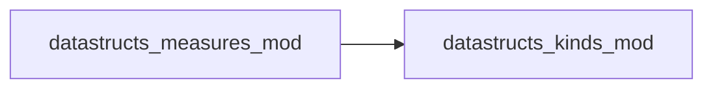

# datastructs_measures_mod

> Statistical accumulator and measurement controller module.

 Provides:
 - `statistical_measure_t`: Online accumulator for statistical moments (mean, variance,
   standard deviation, skewness) across observation points with \(O(1)\) incremental updates.
 - `measure_controller_t`: Controller tracking temporal sampling intervals for uniform,
   logarithmic, or custom grids. (For CTMC/Gillespie dynamics, see also `time_grid_t`).

**Source**: `src/misc/measures.f90`

**Dependencies**

## Contents

- [measure_controller_t](#measure-controller-t)
- [statistical_measure_t](#statistical-measure-t)

## Derived Types

### measure_controller_t

Measure controller for managing time steps
 The idea is that this controller will keep track of the last value added and the last position added
 The procedures will automatically add or not a given position
 `get_pos_array` will return the array of positions in which the value can be added
 `get_max_array_size` will return the maximum size of the array of positions that can be added

#### Components

| Name | Type | Attributes | Description |
|------|------|------------|-------------|
| `last_value_added` | real(kind=dp) |  | Last value added |
| `last_position_added` | integer(kind=i4) |  | Last position added |
| `position_step` | real(kind=dp) |  | Position step size |
| `min_value` | real(kind=dp) |  | Minimum value for the measure |
| `get_pos_array` | procedure(measure_controller_get_pos_array_i) | pointer | Get position array |
| `get_max_array_size` | procedure(measure_controller_get_max_array_size_i) | pointer | Get maximum array size |
| `update` | procedure(measure_controller_update) | pointer | Update measure |

#### Type-Bound Procedures

| Name | Attributes | Description |
|------|------------|-------------|
| `init` |  | Initialize measure controller |
| `reset` |  | Reset measure controller |

### statistical_measure_t

Object to handle statistical measures
 This object will keep track of the statistical measures for a given set of points
 Procedures are available to access the measures

#### Components

| Name | Type | Attributes | Description |
|------|------|------------|-------------|
| `n_samples` | integer(kind=i4) | allocatable | number of samples for each point |
| `sum_values` | real(kind=dp) | allocatable | used to store the values of the measure |
| `sum_values_squares` | real(kind=dp) | allocatable | used to store the squares of the values of the measure |
| `sum_values_thirds` | real(kind=dp) | allocatable | used to store the cubes of the values of the measure |
| `n_size` | integer(kind=i4) |  | Number of points in the measure |
| `max_n_samples` | integer(kind=i4) |  | Maximum number of samples for any point |

#### Type-Bound Procedures

| Name | Attributes | Description |
|------|------------|-------------|
| `init` |  |  |
| `add_point` |  |  |
| `get_mean` |  |  |
| `get_variance` |  |  |
| `get_stddev` |  |  |
| `get_skewness` |  |  |
