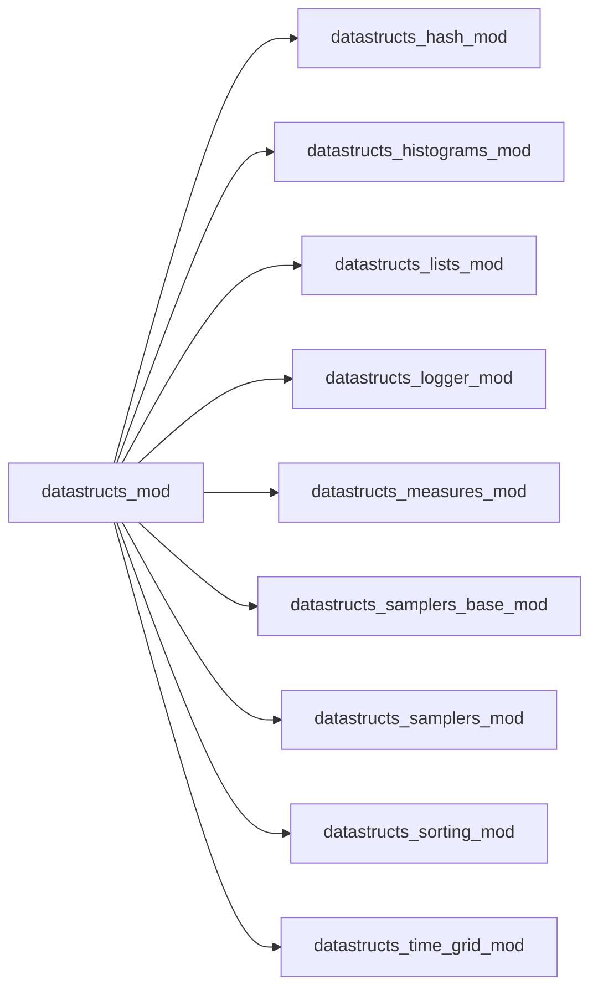

# datastructs_mod

> `datastructs_mod` is the main umbrella module for the `datastructs-fortran` library.

 It re-exports all primary derived types, constructors, and utility procedures:
 - **Weighted Samplers**: `choose_sampler`, `sampler_choices`, `sampler_base_t`
 - **Temporal Observation Grid**: `time_grid_t` (uniform, geometric, logarithmic)
 - **Sorting**: `sort`, `sort_index` (high-performance in-place Introsort)
 - **Lists & Priority Queues**: `dynamical_list_t`, `fixed_list_t`, `maxheap_t`
 - **Hashing & Packing**: `djb2`, `fnv1a`, `pack_pair`
 - **Statistical Measures**: `statistical_measure_t`, `measure_controller_t`, `weighted_histogram_t`
 - **Logging**: `log_unit`, `log_write`, `set_verbose`, `set_level`, etc.
 Hash and packing functions

 High-performance sorting procedures

 Lists and maxheap constructors

 Derived types for lists and maxheap

 Utility functions for lists and maxheap

 Base abstract type for all weighted samplers

 Factory function to instantiate weighted samplers

 Statistical measures and observation time grid for CTMC dynamics

 Logging utilities and constants

**Source**: `src/datastructs_mod.f90`

**Dependencies**

