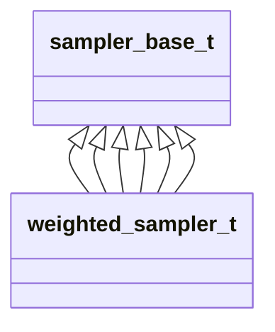

# datastructs_samplers_base_mod

> This module implements the basic structure for weighted samplers

**Source**: `src/samplers/base.f90`

**Dependencies**

## Contents

- [sampler_base_t](#sampler-base-t)

## Derived Types

### sampler_base_t

Base type for all samplers

**Inheritance**

**Attributes**: abstract

#### Components

| Name | Type | Attributes | Description |
|------|------|------------|-------------|
| `weights` | real(kind=dp) | allocatable | Individual weights assigned to each element |
| `n` | integer(kind=i4) |  | Total number of weights |

#### Type-Bound Procedures

| Name | Attributes | Description |
|------|------------|-------------|
| `init_n` |  | Initializes with a fixed number of weights |
| `init_w` |  | Initializes with one additional parameter (e.g. max_weight or ratio) |
| `init_w2` |  | Initializes with two additional parameters (e.g. min_weight and max_weight) |
| `init` |  | Generic initialization interface |
| `reset` |  | Resets the sampler state (clears active weights and counts) |
| `set_weight` |  | Sets the weight for a specific index |
| `set_weight_array` |  | Sets the weights for all indices |
| `add_weight` |  | Adds a delta weight to a specific index |
| `sample` |  | Returns an index sampled proportionally to its weight |
| `remove` |  | Removes a specific index (sets its weight to 0) |
| `sum` |  | Returns the total sum of all active weights |
