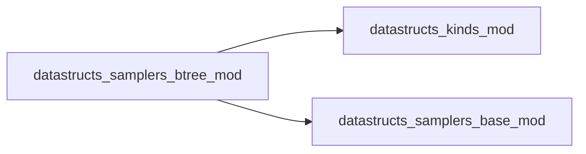
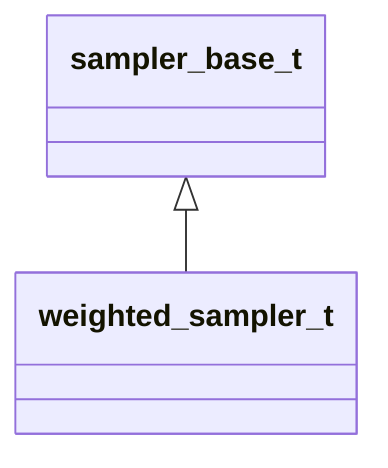

# datastructs_samplers_btree_mod

> Binary tree weighted sampler.

 Maintains a complete binary tree where each node stores the sum of weights
 in its subtree.

 Complexity:
 - **Sampling**: \(O(\log N)\) (top-down binary search)
 - **Weight update**: \(O(\log N)\) (bottom-up propagation)
 - **Memory**: \(O(N)\) (\(2^{\lceil \log_2 N \rceil + 1}\) nodes)

 This sampler is exact, deterministic, and optimal when event rates change
 frequently and unpredictable weight dynamics occur.

**Source**: `src/samplers/btree.f90`

**Dependencies**

## Contents

- [weighted_sampler_t](#weighted-sampler-t)
- [weighted_sampler](#weighted-sampler)

## Derived Types

### weighted_sampler_t

Derived type implementing the binary tree sampler

**Inheritance**

**Extends**: [`sampler_base_t`](/api/datastructs_samplers_base_mod#sampler-base-t)

#### Components

| Name | Type | Attributes | Description |
|------|------|------------|-------------|
| `weights` | real(kind=dp) | allocatable | Individual weights assigned to each element |
| `n` | integer(kind=i4) |  | Total number of weights |
| `tree` | real(kind=dp) | allocatable | Internal binary tree storing partial subtree sums |

#### Type-Bound Procedures

| Name | Attributes | Description |
|------|------------|-------------|
| `init` |  | Generic initialization interface |
| `init_n` |  | Initializes tree capacity for N elements |
| `init_w` |  | Initializes capacity (second argument ignored for btree) |
| `init_w2` |  | Initializes capacity (extra arguments ignored for btree) |
| `reset` |  | Clears all weights in the tree to 0 |
| `set_weight` |  | Sets weight of index in O(log N) |
| `set_weight_array` |  | Sets all weights in O(N) |
| `add_weight` |  | Adds delta weight in O(log N) |
| `sample` |  | Samples an index proportionally to weights in O(log N) |
| `remove` |  | Removes index by setting its weight to 0 in O(log N) |
| `sum` |  | Returns total sum of weights in O(1) (root value) |

## Interfaces

### weighted_sampler

Constructor

**Module procedures**: `weighted_sampler_new`
