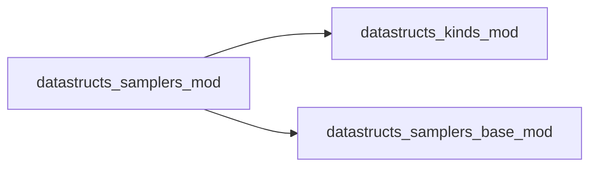

# datastructs_samplers_mod

> Module to select an weighted sampler
 The idea is that it contains the list of indexes up to a size n,
 and each index has an weight
 The sampling is done proportionally to the weights.
 It depends on the `rndgen-fortran` module, found at <https://github.com/wcota/rndgen-fortran>
 Each sampler algorithm is implemented separately.
 Example:
 ```fortran
 program example_sampler
     use datastructs_mod
     use datastructs_kinds_mod
     use rndgen_mod
     implicit none

     type(rndgen) :: gen
     class(sampler_base_t), allocatable :: my_sampler
     integer(kind=i4) :: i
     real(kind=dp), parameter :: weights(*) = [100.0_dp, 50.0_dp, 200.0_dp, 25.0_dp]
     integer(kind=i4), allocatable :: count_times(:)
     integer(kind=i4) :: selected_index
     integer(kind=i4), parameter :: n_samples = 10000

     ! choose the sampler algorithm
     call choose_sampler(my_sampler, 'btree')
     call my_sampler%init(size(weights))
     call my_sampler%set_weight_array(weights)

     ! initialize the random generator with a seed
     call gen%init(12345)

     ! count the number of times each element was selected
     allocate(count_times(size(weights)))
     count_times = 0

     ! Sample from the distribution
     do i = 1, n_samples
         selected_index = my_sampler%sample(gen)
         !write(*, fmt_general) "Selected index:", selected_index
         count_times(selected_index) = count_times(selected_index) + 1
     end do

     ! Print the result
     write(*, fmt_general) "For n_samples = ", n_samples
     do i = 1, size(weights)
         write(*, fmt_general) "@ Index:", i, " Weight:", weights(i), "Count:", count_times(i), "Prob:", 1.0_dp * count_times(i) / sum(count_times), "Expected prob:", weights(i) / sum(weights)
     end do
 end program example_sampler
 ```

**Source**: `src/samplers/samplers.f90`

**Dependencies**



## Contents

- [choose_sampler](#choose-sampler)

## Variables

| Name | Type | Attributes | Description |
|------|------|------------|-------------|
| `sampler_choices` | character(len=*) | parameter | List of available sampler algorithms |

## Subroutines

### choose_sampler

Subroutine to allocate a `class(sampler_base_t)` to its respective object

```fortran
subroutine choose_sampler(weighted_sampler, selected_algorithm)
```

**Arguments**

| Name | Type | Intent | Attributes | Description |
|------|------|--------|------------|-------------|
| `weighted_sampler` | class([sampler_base_t](/api/datastructs_samplers_base_mod#sampler-base-t)) | out | allocatable |  |
| `selected_algorithm` | character(len=*) | in |  |  |
