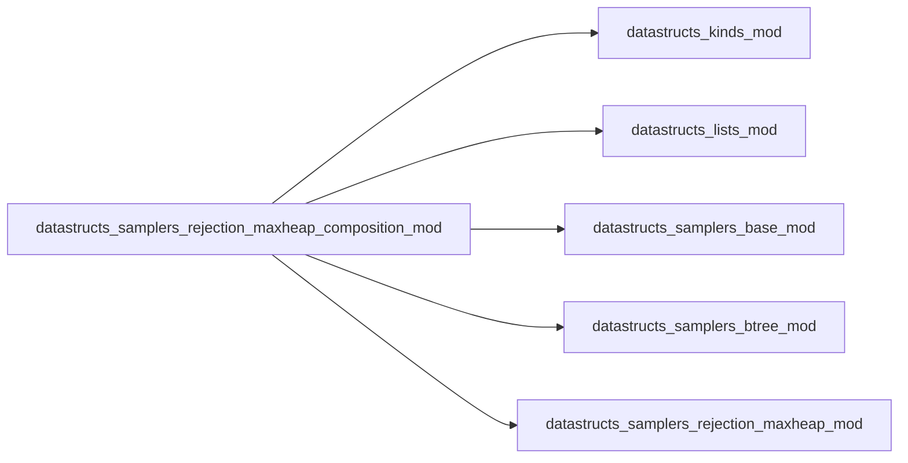
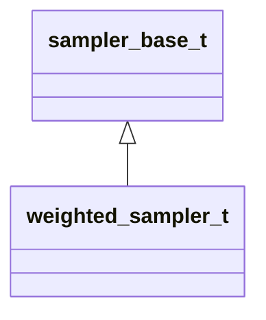

# datastructs_samplers_rejection_maxheap_composition_mod

> Composition and rejection weighted sampler with geometric binning.

 Implements the composition-rejection algorithm of St-Onge et al. (2019):
 > St-Onge, G., Young, J. G., Hébert-Dufresne, L., & Dubé, L. J. (2019).
 > *Efficient sampling of spreading processes on complex networks using a composition and rejection algorithm.*
 > Comput. Phys. Commun., 240, 30–37. <https://doi.org/10.1016/j.cpc.2019.02.008>

 Partitions weights geometrically into \( q = \lceil \log_2(w_{\text{max}} / w_{\text{min}}) \rceil + 1 \)
 bins such that in each bin \( B_k \), all weights satisfy \( w_i \in [w_{\text{min}} 2^{k-1}, w_{\text{min}} 2^k) \).
 A small binary tree (`btree_t`) of size \( q \) selects the active bin in \( O(\log q) \),
 and rejection sampling inside the bin accepts with efficiency \( \ge 50\% \).

 Complexity:
 - **Sampling**: \( O(\log q) \) expected time (effectively \( O(1) \) for typical physical rate ranges).
 - **Weight update**: \( O(\log q + \log N_k) \).
 - **Memory**: \( O(N) \).

**Source**: `src/samplers/rejection_maxheap_composition.f90`

**Dependencies**

## Contents

- [weighted_sampler_t](#weighted-sampler-t)
- [weighted_sampler](#weighted-sampler)

## Derived Types

### weighted_sampler_t

Derived type implementing the composition-rejection sampler

**Inheritance**

**Extends**: [`sampler_base_t`](/api/datastructs_samplers_base_mod#sampler-base-t)

#### Components

| Name | Type | Attributes | Description |
|------|------|------------|-------------|
| `weights` | real(kind=dp) | allocatable | Individual weights assigned to each element |
| `n` | integer(kind=i4) |  | Total number of weights |
| `samplers` | type([weighted_sampler_t](/api/datastructs_samplers_rejection_mod#weighted-sampler-t)) | allocatable | Array of sub-samplers for each geometric bin (size q) |
| `q` | integer(kind=i4) |  | Total number of geometric weight bins |
| `btree` | type([weighted_sampler_t](/api/datastructs_samplers_rejection_mod#weighted-sampler-t)) |  | Binary tree of size q selecting active bins proportionally to bin totals |
| `sampler_of_index` | integer(kind=i4) | allocatable | Map from element index to its current bin (1..q) |
| `wmin` | real(kind=dp) |  | Minimum anticipated weight bound |
| `wmax` | real(kind=dp) |  | Maximum anticipated weight bound |

#### Type-Bound Procedures

| Name | Attributes | Description |
|------|------------|-------------|
| `init` |  | Generic initialization interface |
| `init_n` |  | Initializes with capacity N (default wmin=1, wmax=N) |
| `init_w` |  | Initializes with capacity N and known wmax |
| `init_w2` |  | Initializes with capacity N, wmin, and wmax |
| `reset` |  | Clears all bins and the selection tree |
| `set_weight` |  | Assigns weight to an index and places it in the proper bin |
| `set_weight_array` |  | Sets all weights |
| `add_weight` |  | Adds delta weight and re-bins if necessary |
| `sample` |  | Samples an index via composition then rejection |
| `remove` |  | Removes element from its bin in O(log q + log N_k) |
| `sum` |  | Returns total sum of weights across all bins in O(1) |
| `sampler_pos` |  | Helper calculating target bin index for a given weight |

## Interfaces

### weighted_sampler

Constructor

**Module procedures**: `weighted_sampler_new`
