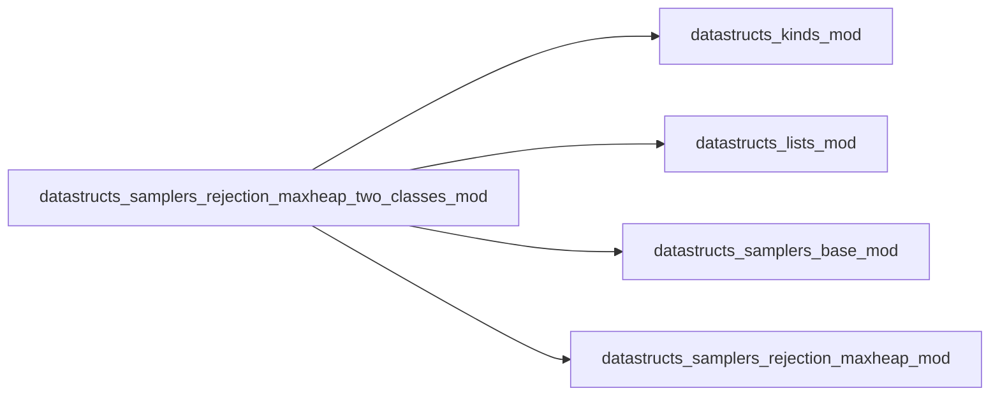
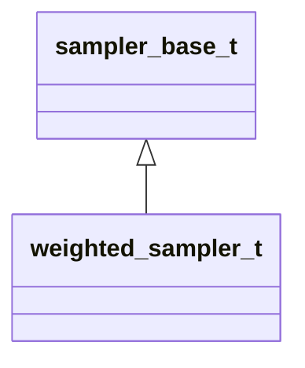

# datastructs_samplers_rejection_maxheap_two_classes_mod

> Two-class rejection weighted sampler with Max-Heap tracking in each class.

 Combines two-class rate partitioning with dynamic Max-Heap tracking in both
 subclasses, ensuring exact maximum weight tracking and high acceptance efficiency.

 Complexity:
 - **Sampling**: \( O(1) \) expected trials.
 - **Weight update**: \( O(\log N) \) heap adjustment within the element's class.
 - **Memory**: \( O(N) \).

**Source**: `src/samplers/rejection_maxheap_two_classes.f90`

**Dependencies**

## Contents

- [weighted_sampler_t](#weighted-sampler-t)
- [weighted_sampler](#weighted-sampler)

## Derived Types

### weighted_sampler_t

Derived type implementing two-class rejection with Max-Heap tracking

**Inheritance**

**Extends**: [`sampler_base_t`](/api/datastructs_samplers_base_mod#sampler-base-t)

#### Components

| Name | Type | Attributes | Description |
|------|------|------------|-------------|
| `weights` | real(kind=dp) | allocatable | Individual weights assigned to each element |
| `n` | integer(kind=i4) |  | Total number of weights |
| `samplers` | type([weighted_sampler_t](/api/datastructs_samplers_rejection_mod#weighted-sampler-t)) |  | Sub-samplers with max-heaps for class 1 and class 2 |
| `threshold` | real(kind=dp) |  | Weight threshold separating the two classes |
| `sampler_of_index` | integer(kind=i4) | allocatable | Map from element index to class index (1 or 2) |

#### Type-Bound Procedures

| Name | Attributes | Description |
|------|------------|-------------|
| `init` |  | Generic initialization interface |
| `init_n` |  | Initializes sampler with capacity N |
| `init_w` |  | Initializes with capacity N and custom threshold |
| `init_w2` |  | Initializes with capacity N and custom threshold |
| `reset` |  | Clears both sub-samplers and index maps |
| `set_weight` |  | Sets weight for an index in O(log N) |
| `set_weight_array` |  | Sets all weights in O(N log N) |
| `add_weight` |  | Adds delta weight in O(log N) |
| `sample` |  | Selects class proportionally then samples via rejection |
| `remove` |  | Removes element in O(log N) |
| `sum` |  | Returns sum of weights across both classes in O(1) |

## Interfaces

### weighted_sampler

Constructor

**Module procedures**: `weighted_sampler_new`
