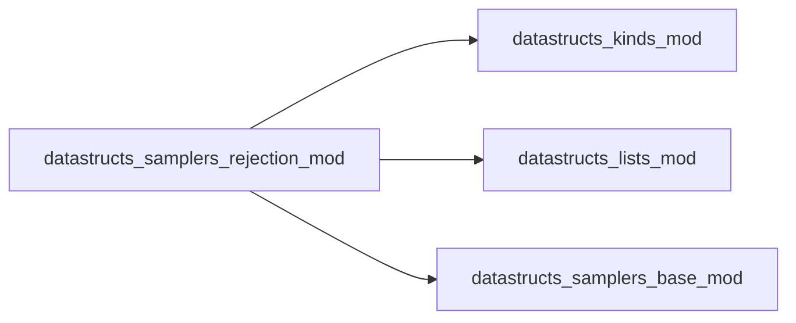
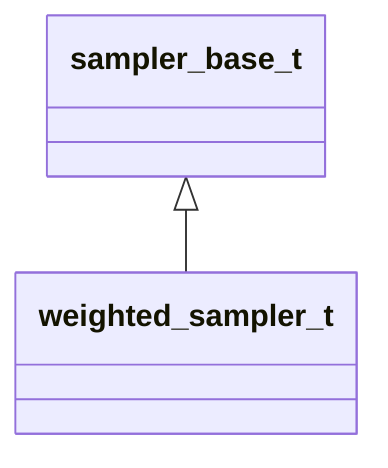

# datastructs_samplers_rejection_mod

> Rejection weighted sampler.

 Selects an active element uniformly at random and accepts it with probability
 \( P(\text{accept}) = w_i / w_{\text{max}} \).

 Complexity:
 - **Sampling**: \( O(1) \) expected trials when weights are relatively homogeneous
   (average trials \( \approx w_{\text{max}} / \bar{w} \)).
 - **Weight update**: \( O(1) \) (updates weight and adjusts `max_weight`).
 - **Memory**: \( O(N) \) (stores active indices and position index map).

**Source**: `src/samplers/rejection.f90`

**Dependencies**

## Contents

- [weighted_sampler_t](#weighted-sampler-t)
- [weighted_sampler](#weighted-sampler)

## Derived Types

### weighted_sampler_t

Derived type implementing the rejection sampler

**Inheritance**

**Extends**: [`sampler_base_t`](/api/datastructs_samplers_base_mod#sampler-base-t)

#### Components

| Name | Type | Attributes | Description |
|------|------|------------|-------------|
| `weights` | real(kind=dp) | allocatable | Individual weights assigned to each element |
| `n` | integer(kind=i4) |  | Total number of weights |
| `indices` | type([dynamical_list_t](/api/datastructs_lists_dynamical_list_mod#dynamical-list-t)) | allocatable | Dynamic list of active (non-zero weight) indices |
| `position_of` | integer(kind=i4) | allocatable | Map from element index to its position in `indices` |
| `current_sum` | real(kind=dp) |  | Current sum of all active weights |
| `max_weight` | real(kind=dp) |  | Maximum weight threshold for rejection |

#### Type-Bound Procedures

| Name | Attributes | Description |
|------|------------|-------------|
| `init` |  | Generic initialization interface |
| `init_n` |  | Initializes sampler with capacity N |
| `init_w` |  | Initializes with capacity N and known max_weight |
| `init_w2` |  | Initializes with capacity N and extra bounds |
| `reset` |  | Clears active elements and resets sum and max_weight |
| `set_weight` |  | Sets weight for an index in O(1) |
| `set_weight_array` |  | Sets all weights in O(N) |
| `add_weight` |  | Adds delta weight to an index in O(1) |
| `sample` |  | Samples an index via rejection sampling |
| `remove` |  | Removes index by setting weight to 0 in O(1) |
| `sum` |  | Returns total sum of weights in O(1) |

## Interfaces

### weighted_sampler

Constructor

**Module procedures**: `weighted_sampler_new`
