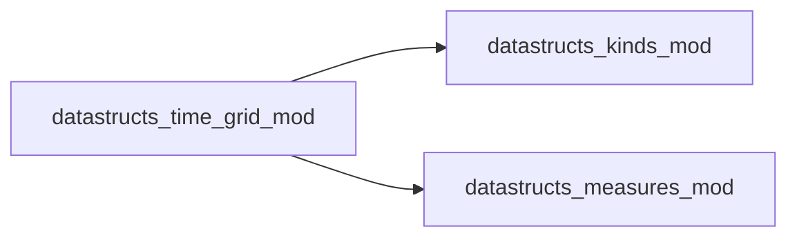

# datastructs_time_grid_mod

> This module implements a fast time grid for stochastic dynamics (e.g. Gillespie/CTMC).
 It precalculates observation time ticks and records piecewise-constant states
 in O(1) amortized time per event, with zero heap allocations in the event loop.

**Source**: `src/misc/time_grid.f90`

**Dependencies**

## Contents

- [time_grid_t](#time-grid-t)

## Derived Types

### time_grid_t

Derived type representing a precomputed observation time grid for Gillespie and CTMC simulations

#### Components

| Name | Type | Attributes | Description |
|------|------|------------|-------------|
| `times` | real(kind=dp) | allocatable | Array of precalculated time ticks |
| `n_points` | integer(kind=i4) |  | Total number of observation points |
| `current_tick` | integer(kind=i4) |  | Next tick to be evaluated (1..n_points+1) |

#### Type-Bound Procedures

| Name | Attributes | Description |
|------|------------|-------------|
| `init_uniform` |  | Initialize evenly spaced grid |
| `init_geometric` |  | Initialize geometrically spaced grid |
| `init_log` |  | Initialize logarithmically spaced grid |
| `init_custom` |  | Initialize custom user-provided grid |
| `reset` |  | Reset tick pointer to 1 for new realization |
| `size` |  | Return number of grid points |
| `time_at` |  | Return timestamp at specified index |
| `get_times` |  | Return copy of all timestamps |
| `next_time` |  | Timestamp of next pending tick |
| `has_next` |  | True if unobserved ticks remain |
| `needs_update` |  | True if current time reached next tick |
| `collect_ticks` |  | Return index range of elapsed ticks |
| `record` |  | Record scalar state variable(s) into statistical measures for all elapsed ticks |
