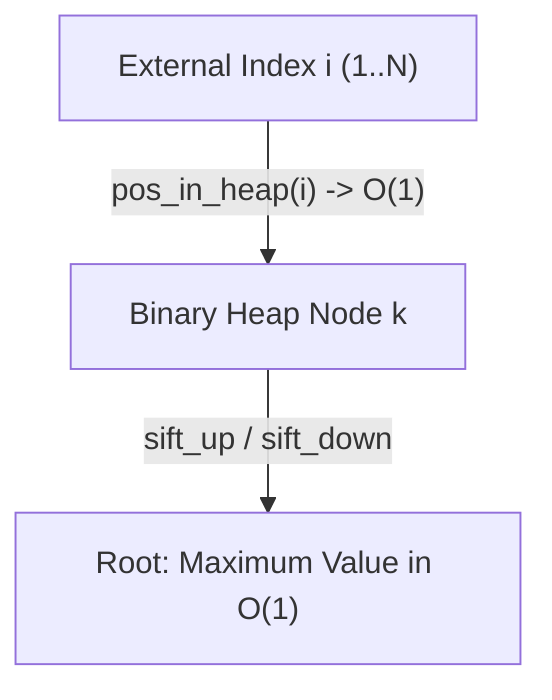

# Dynamic Containers & Priority Queues

`datastructs-fortran` provides three core data structures optimized for low-overhead element tracking:

1. **`dynamical_list_t`**: Unordered dynamic array with $O(1)$ removal via swap-with-last.
2. **`maxheap_t`**: Binary Max-Heap priority queue supporting $O(\log N)$ updates by external index.
3. **`fixed_list_t`**: Doubly-linked node list with fixed-size arrays.

---

## 1. Dynamic List (`dynamical_list_t`)

When element order does not need to be preserved, `dynamical_list_t` removes elements in $O(1)$ time by overwriting the removed position with the last element of the list:

```fortran
use datastructs_mod, only: dynamical_list_t
implicit none

type(dynamical_list_t) :: dl

call dl%init(capacity=100)
call dl%add(42)
call dl%add([10, 20, 30, 40])

! Remove element at position 2 in O(1)
call dl%remove(2)

! Remove range of positions [2, 4]
call dl%remove(2, 4)

! Remove array of positions in descending order
call dl%remove([1, 3])

! Reset used count without deallocation
call dl%reset()
```

---

## 2. Max-Heap Priority Queue (`maxheap_t`)

A standard binary heap only allows efficiently reading or removing the root ($O(1)$ peek, $O(\log N)$ pop).

`maxheap_t` extends the standard heap with an **external index map** (`pos_in_heap`). This permits updating or removing *any arbitrary element* $i \in \{1, \dots, N\}$ in $O(\log N)$ time:



```fortran
use datastructs_maxheap_mod
implicit none

type(maxheap_t) :: heap

call heap%init(n=1000)

! Insert values associated with external index
call heap%add(external_index=1, value=12.5_dp)
call heap%add(external_index=2, value=45.0_dp)
call heap%add(external_index=3, value=8.2_dp)

! Inspect maximum element in O(1)
print *, "Max index:", heap%max_index()  ! 2
print *, "Max value:", heap%max_value()  ! 45.0

! Modify weight of existing index in O(log N)
call heap%add_weight(external_index=1, weight=50.0_dp)

! Remove element from heap in O(log N)
call heap%remove(external_index=2)
```

---

## 3. Doubly-Linked Fixed List (`fixed_list_t`)

For linked chains where contiguous reallocation is undesirable, `fixed_list_t` provides pointer-chained blocks:

```fortran
use datastructs_lists_fixed_list_mod
implicit none

type(fixed_list_t), pointer :: head, current

call new_fixed_list_pointer(head, chunk_size=64)
head%list(1) = 100
```
