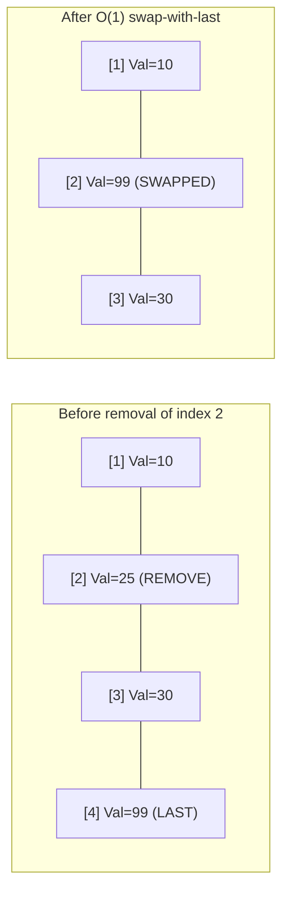
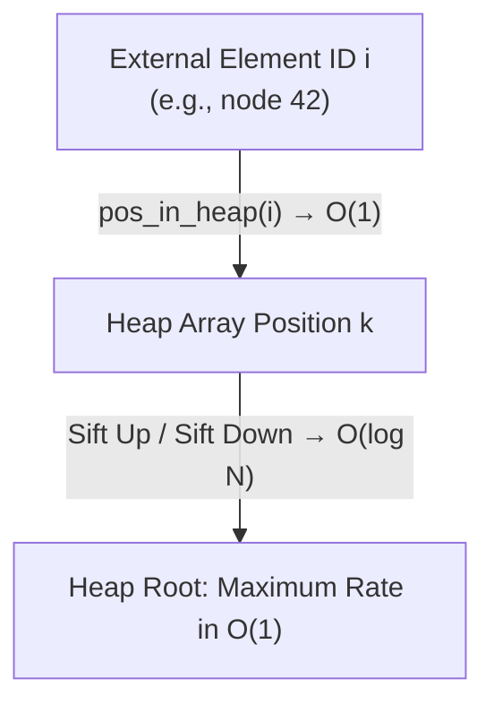
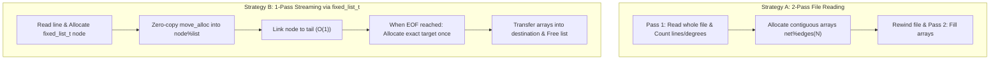

# Containers, Priority Queues & Linked Lists

`datastructs-fortran` provides three specialized containers designed for high-performance scientific simulations:

1. **`dynamical_list_t`**: Unordered dynamic array with $O(1)$ removal via swap-with-last.
2. **`maxheap_t`**: Binary Max-Heap priority queue supporting $O(\log N)$ updates by external index.
3. **`fixed_list_t`**: Doubly-linked node list holding variable-sized array payloads.

---

## 1. Dynamic List (`dynamical_list_t`)

In scientific simulations (e.g. tracking active edges, infected individuals, or free particles), maintaining strict element ordering is often unnecessary, but elements must be added and removed frequently.

Standard array removals require shifting all subsequent elements down by one ($O(N)$ operations), creating a severe bottleneck. `dynamical_list_t` replaces the deleted element with the current last element, performing deletions in strictly **$O(1)$ time**.



### Basic Usage

```fortran
use datastructs_mod, only: dynamical_list_t, unique_values
implicit none

type(dynamical_list_t) :: dl
integer(kind=i4), allocatable :: u_vals(:)

! Initialize with an initial capacity (auto-grows if exceeded)
call dl%init(capacity=100)

! Add single elements or arrays
call dl%add(10)
call dl%add([25, 30, 99])

! Access size and capacity
print *, "Current count:", dl%get_size()     ! 4
print *, "Max capacity:", dl%get_capacity() ! 100

! Read element
print *, "Element at index 2:", dl%get(2)   ! 25

! O(1) removal of a single position
call dl%remove(2)  ! Element 99 moves into position 2

! Removal of a contiguous range of positions [1, 2]
call dl%remove(1, 2)

! Removal of a specific list of positions
call dl%add([100, 200, 300, 400])
call dl%remove([1, 3])  ! Removes positions 1 and 3 safely in descending order

! Extract unique values
u_vals = dl%unique()

! Fast reset (keeps capacity, resets count to 0 without reallocating)
call dl%reset()
```

---

## 2. Max-Heap Priority Queue (`maxheap_t`)

In algorithms like Gillespie event-driven simulations or discrete event queues, one needs to continuously find the event with the maximum propensity/rate while updating individual rates as system states change.

A standard binary heap only allows reading or removing the root ($O(1)$ peek, $O(\log N)$ pop), but cannot locate an arbitrary item $i$ in less than $O(N)$ without a scan.

`maxheap_t` solves this by embedding an **external index map** (`pos_in_heap`). Every element is assigned an external identity $i \in \{1, \dots, N\}$. Whenever elements sift up or down, their positions in the heap are kept in sync, enabling **$O(\log N)$ updates and deletions for any arbitrary element**.



### Methods and Complexity

| Operation | Method | Complexity | Description |
| :--- | :--- | :--- | :--- |
| **Max value** | `heap%max_value()` | $O(1)$ | Returns maximum weight stored at the root |
| **Max index** | `heap%max_index()` | $O(1)$ | Returns external index of maximum element |
| **Add / Set** | `heap%add(id, val)` | $O(\log N)$ | Inserts or updates weight for element `id` |
| **Update Delta** | `heap%add_weight(id, dw)` | $O(\log N)$ | Adds `dw` to current weight of element `id` |
| **Remove** | `heap%remove(id)` | $O(\log N)$ | Removes arbitrary element `id` from the queue |
| **Check Presence** | `heap%contains(id)` | $O(1)$ | Tests if element `id` is currently active |

### Code Example

```fortran
use datastructs_mod, only: maxheap_t, dp
implicit none

type(maxheap_t) :: queue

! Initialize heap with capacity for 500 external elements
call queue%init(n=500)

! Add items with their external identities
call queue%add(external_index=1, value=12.5_dp)
call queue%add(external_index=2, value=85.0_dp)
call queue%add(external_index=3, value=4.2_dp)

! Inspect the maximum in O(1)
print *, "Max index:", queue%max_index()  ! 2
print *, "Max value:", queue%max_value()  ! 85.0_dp

! Dynamically update an arbitrary element in O(log N)
call queue%add_weight(external_index=3, weight=90.0_dp)

! Now element 3 is the new maximum (4.2 + 90.0 = 94.2)
print *, "New max index:", queue%max_index()  ! 3

! Remove element 2 in O(log N)
call queue%remove(external_index=2)
```

---

## 3. Doubly-Linked Lists with Array Payloads (`fixed_list_t`)

`fixed_list_t` is a doubly-linked node containing an allocatable integer array `list(:)` along with `next` and `prev` pointers.

```fortran
type :: fixed_list_t
    integer(kind=i4), allocatable :: list(:)
    type(fixed_list_t), pointer   :: next => null()
    type(fixed_list_t), pointer   :: prev => null()
    ! ... metadata (n, initial_index, final_index)
end type fixed_list_t
```

### The Ingestion Problem: 1-Pass vs 2-Pass I/O

When reading scientific datasets from disk (e.g. graph edge lists, hypergraphs, transaction traces, or polygon meshes), the file often contains variable-length records:
```text
1 4 9 12
2 7
3 5 8 11 14 20
```
In this scenario:
1. The **total number of lines/records** is not known beforehand.
2. The **length of each line** varies dynamically.

In Fortran, repeatedly expanding a flat array via concatenation `array = [array, new_val]` is $O(N^2)$ due to full memory reallocations.

#### Architectural Tradeoff: Is `fixed_list_t` necessary?

Two primary strategies exist:



| Criterion | Strategy A: 2-Pass I/O | Strategy B: 1-Pass via `fixed_list_t` |
| :--- | :--- | :--- |
| **Disk/Network Reads** | Reads entire file **twice** | Reads file **exactly once** |
| **Stream Suitability** | Fails on non-seekable streams (`stdin`, pipes, sockets, gzipped streams) | Works seamlessly on any streaming input |
| **Memory Locality** | Direct contiguous allocation | Nodes allocated dynamically, transferred at the end |
| **Best Used When** | Files are small/medium and stored on fast local NVMe SSDs | Large network files, remote filesystems (NFS), compressed pipelines, or when I/O latency dominates |

---

### Example: Streaming Ingestion with Zero-Copy `move_alloc`

The pattern below illustrates how `fixed_list_t` can be used to stream an unknown number of variable-length integer lines in a single pass without copying array contents:

```fortran
program demo_stream_ingest
    use datastructs_mod, only: fixed_list_t, i4
    implicit none

    type(fixed_list_t), pointer :: head => null(), tail => null(), current => null()
    integer(kind=i4), allocatable :: buffer(:)
    integer(kind=i4) :: count_records, i

    count_records = 0

    ! Simulating 1-pass streaming ingestion:
    do i = 1, 3
        count_records = count_records + 1

        ! Allocate and populate a temporary line buffer
        allocate(buffer(i + 1))
        buffer = [(10 * i + j, j = 1, i + 1)]

        ! Allocate new node
        allocate(current)
        
        ! Zero-copy transfer: moves buffer into current%list without copying memory
        call move_alloc(buffer, current%list)
        current%next => null()

        ! Append to tail in O(1)
        if (count_records == 1) then
            head => current
            tail => current
            current%prev => null()
        else
            tail%next => current
            current%prev => tail
            tail => current
        end if
    end do

    print *, "Total records ingested in 1 pass:", count_records

    ! Iterate through the linked list to process records
    current => head
    do while (associated(current))
        print *, "Record payload:", current%list
        current => current%next
    end do

    ! Clean up nodes
    call clean_list(head, tail)

contains

    subroutine clean_list(h, t)
        type(fixed_list_t), pointer :: h, t
        type(fixed_list_t), pointer :: ptr, nxt

        ptr => h
        do while (associated(ptr))
            nxt => ptr%next
            if (allocated(ptr%list)) deallocate(ptr%list)
            deallocate(ptr)
            ptr => nxt
        end do
        nullify(h, t)
    end subroutine clean_list

end program demo_stream_ingest
```
