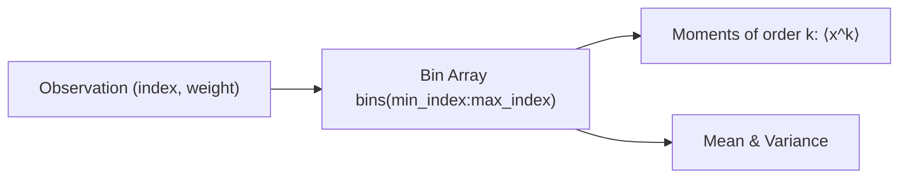

# Statistical Accumulators & Histograms

Stochastic simulations typically generate thousands of realizations of temporal trajectories or random variables. Storing the raw time series of all runs in memory often exceeds available RAM.

`datastructs-fortran` provides online statistical accumulators that compute exact sample statistics (mean, variance, standard deviation, and skewness) in **$O(1)$ time and $O(1)$ memory per observation point**, as well as arbitrary-order weighted histograms.

---

## 1. Online Moment Accumulator (`statistical_measure_t`)

`statistical_measure_t` maintains running sums of samples, squares, and cubes across $M$ observation points:

$$
S_1 = \sum_{i=1}^N x_i, \quad S_2 = \sum_{i=1}^N x_i^2, \quad S_3 = \sum_{i=1}^N x_i^3
$$

From these sums, it extracts unbiased sample statistics on demand:

- **Mean**: $\bar{x} = \frac{S_1}{N}$
- **Variance**: $s^2 = \frac{1}{N - 1} \left( S_2 - \frac{S_1^2}{N} \right)$
- **Standard Deviation**: $s = \sqrt{s^2}$
- **Skewness**: $\gamma_1 = \frac{\frac{1}{N} \sum (x_i - \bar{x})^3}{s^3}$

### Basic Usage with CTMC Trajectories

```fortran
use datastructs_mod, only: statistical_measure_t, time_grid_t, dp, i4
implicit none

type(time_grid_t) :: grid
type(statistical_measure_t) :: measure
real(kind=dp), allocatable :: mean_series(:), std_series(:)
real(kind=dp) :: t, state
integer(kind=i4) :: realization

! 1. Initialize observation grid (e.g. 100 points from 0 to 10)
call grid%init_uniform(tmin=0.0_dp, tmax=10.0_dp, dt=0.1_dp)

! 2. Initialize measure to track grid%size() discrete timestamps
call measure%init(grid%size())

! 3. Accumulate data across Monte Carlo realizations
do realization = 1, 1000
    call grid%reset()
    t = 0.0_dp
    state = 100.0_dp  ! Initial population

    do while (grid%has_next() .and. t < 10.0_dp)
        t = t + 0.05_dp
        state = state - 0.2_dp

        ! Record current state into measure at reached grid ticks
        call grid%record(measure, t, state)
    end do
end do

! 4. Query statistics for all grid points simultaneously
mean_series = measure%get_mean()
std_series  = measure%get_stddev()

print *, "Final point mean:", mean_series(grid%size())
print *, "Final point std:", std_series(grid%size())
print *, "Samples collected at tick 1:", measure%n_samples(1)
```

---

## 2. Weighted Histograms (`weighted_histogram_t`)

For calculating probability distributions, energy spectra, or degree distributions, `weighted_histogram_t` manages discrete bin ranges with arbitrary weighting:



### Features
- **Arbitrary Index Range**: Supports custom lower and upper bin indices $[i_{\min}, i_{\max}]$ (including negative offsets).
- **Arbitrary Statistical Moments**: Computes normalized $k$-th order moments:

$$
\langle x^k \rangle = \sum_{i=i_{\min}}^{i_{\max}} \left(\frac{i}{\text{norm\_factor}}\right)^k \frac{\text{bins}(i)}{\text{total\_weight}}
$$

### Code Example

```fortran
use datastructs_mod, only: weighted_histogram_t, dp, i4
implicit none

type(weighted_histogram_t) :: hist
real(kind=dp) :: mu, var, m3

! Initialize bins spanning from index 1 to 50
call hist%init(min_index=1, max_index=50)

! Add counts or weighted probabilities to bins
call hist%add_value(index=10, weight=2.5_dp)
call hist%add_value(index=20, weight=5.0_dp)
call hist%add_value(index=20, weight=1.5_dp)  ! Bins accumulate weights
call hist%add_value(index=30, weight=1.0_dp)

! Compute basic statistics
mu  = hist%get_mean()
var = hist%get_variance()

print *, "Total accumulated weight:", hist%total_weight
print *, "Distribution mean:", mu
print *, "Distribution variance:", var

! Compute 3rd order moment with normalization
m3 = hist%get_moment(k=3)
print *, "3rd moment:", m3

! Reset all bins to zero without reallocating
call hist%reset()
```

---

## 3. Custom Step Sampling (`measure_controller_t`)

For simulations that do not use `time_grid_t` but need to throttle measurement points across variable time scales, `measure_controller_t` provides configurable step thresholds and callback controllers.
