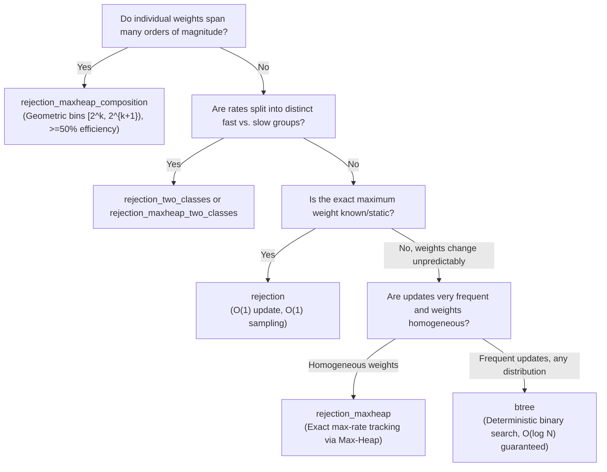

# Continuous-Time Weighted Samplers

Stochastic simulation algorithms—such as Gillespie's Stochastic Simulation Algorithm (SSA), Kinetic Monte Carlo (KMC), and Continuous-Time Markov Chains (CTMC)—require sampling an event $i \in \{1, \dots, N\}$ with probability proportional to its transition rate (or weight) $w_i$:

$$P(i) = \frac{w_i}{W}, \quad W = \sum_{j=1}^N w_j$$

In large-scale systems (such as epidemic models like hyperSIS, network contact processes, and chemical reaction networks), transition rates dynamically change every time an event occurs. Choosing the right data structure for the sampler determines whether the simulation scales as $O(1)$, $O(\log N)$, or degrades to $O(N)$.

---

## Sampler Selection Decision Tree



---

## Algorithm Specifications

| Algorithm Identifier | Type | Sampling Time | Update Time | Memory | Best Suited For |
| :--- | :--- | :--- | :--- | :--- | :--- |
| `btree` | Prefix Tree | $O(\log N)$ | $O(\log N)$ | $O(N)$ | General purpose; robust against arbitrary rate distributions. |
| `rejection` | Rejection | $O(1)$ expected | $O(1)$ | $O(N)$ | Known upper bound $w_{\max}$; homogeneous or bounded rates. |
| `rejection_maxheap` | Heap + Rejection | $O(1)$ expected | $O(\log N)$ | $O(N)$ | Dynamic maximum weight; rates stay within a moderate factor. |
| `rejection_two_classes` | 2-Bin Partition | $O(1)$ expected | $O(1)$ | $O(N)$ | Two distinct activity levels (e.g., infected vs. recovered). |
| `rejection_maxheap_two_classes` | 2-Heap Partition | $O(1)$ expected | $O(\log N)$ | $O(N)$ | Two distinct activity levels with dynamic maximums. |
| `rejection_maxheap_composition` | Geometric Bins | $O(\log q)$ | $O(\log q + \log N_k)$ | $O(N)$ | Heavy-tailed distributions (scale-free networks, hubs). |

---

## The Polymorphic Interface (`sampler_base_t`)

All 6 algorithms extend the abstract class `sampler_base_t` and can be instantiated transparently using `choose_sampler`:

```fortran
use datastructs_samplers_mod
implicit none

class(sampler_base_t), allocatable :: sampler

! Instantiate a binary tree sampler with capacity for 100,000 weights
call choose_sampler(sampler, "btree", 100000)

! Or instantiate a geometric composition sampler
call choose_sampler(sampler, "rejection_maxheap_composition", 100000)

! Common API:
call sampler%set_weight(10, 2.5_dp)     ! Update weight of element 10
call sampler%add_weight(10, 0.5_dp)     ! Increment weight of element 10
call sampler%remove(15)                 ! Set weight to 0 and deactivate

! Sample an index:
sampled_index = sampler%sample(rnd)
total_rate = sampler%sum()
```

---

## Deep Dive: Geometric Composition (`rejection_maxheap_composition`)

When event rates vary widely (e.g. from $10^{-4}$ to $10^4$), standard rejection sampling suffers from catastrophic trial rejection rates because:

$$\mathbb{E}[\text{trials}] = \frac{w_{\max}}{\langle w \rangle} \gg 1$$

The composition method (St-Onge et al., *Computer Physics Communications* 2019) partitions active elements into geometric bins:

$$B_k = \{ i : w_i \in [w_{\min} 2^{k-1}, w_{\min} 2^k) \}$$

1. **Bin Selection**: A tiny binary tree of size $q = \lceil \log_2(w_{\max} / w_{\min}) \rceil + 1$ samples the active bin in $O(\log q) \approx O(1)$ time.
2. **Within-Bin Rejection**: Rejection sampling inside the chosen bin accepts with efficiency:
   $$\eta \ge \frac{w_{\min} 2^{k-1}}{w_{\min} 2^k} = \frac{1}{2} = 50\%$$

This guarantees that acceptance never drops below 50%, regardless of how skewed the global weight distribution is.
