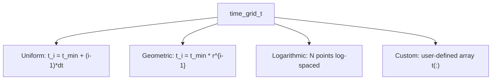

# Temporal Observation Grid (`time_grid_t`)

In continuous-time stochastic processes (Gillespie SSA, CTMC, epidemic models, jump diffusion), system state transitions occur at irregular, random time intervals $\Delta t \sim \text{Exp}(\lambda)$.

Evaluating and recording observables at every single microscopic jump event is often impossible or memory-prohibitive (e.g. $10^9$ events). Instead, experimental and numerical observations are usually recorded at a pre-established sequence of timestamps $\{t_1, t_2, \dots, t_M\}$.

The `time_grid_t` derived type provides a high-performance, piecewise-constant state recorder with:
- **Zero dynamic memory allocation** during simulation event loops.
- **$O(1)$ amortized recording time** per stochastic event.
- **Support for uniform, geometric, logarithmic, and arbitrary custom grids**.

---

## Grid Topologies



### 1. Uniform Grid (`init_uniform`)
Evenly spaced observation ticks:
$$t_i = t_{\min} + (i - 1) \Delta t, \quad t_i \le t_{\max}$$

```fortran
type(time_grid_t) :: grid
call grid%init_uniform(tmin=0.0_dp, tmax=100.0_dp, dt=0.5_dp)
```

### 2. Geometric Progression (`init_geometric`)
Spaced by a constant ratio $r > 1$:
$$t_i = t_{\min} \cdot r^{i - 1}, \quad t_i \le t_{\max}$$
Essential for capturing rapid initial transients followed by slow, multi-scale power-law relaxations.

```fortran
call grid%init_geometric(tmin=1.0e-3_dp, tmax=1.0e4_dp, ratio=1.1_dp)
```

### 3. Logarithmic Grid (`init_log`)
Distributes exactly $M$ points uniformly in log-space:

```fortran
call grid%init_log(tmin=1.0e-2_dp, tmax=1.0e3_dp, n_points=500)
```

---

## High-Performance Event Loop Integration

In a Gillespie loop, simply check `needs_update` and call `record`:

```fortran
program test_ctmc
    use datastructs_mod
    implicit none

    type(time_grid_t) :: grid
    type(statistical_measure_t) :: infected_measure
    real(kind=dp) :: t, dt, state

    call grid%init_uniform(0.0_dp, 50.0_dp, 0.1_dp)
    call infected_measure%init(grid%size())

    t = 0.0_dp
    state = 10.0_dp

    do while (t < 50.0_dp)
        ! Advance stochastic clock
        dt = 0.03_dp  ! drawn from exponential distribution
        t = t + dt

        ! Record state if elapsed time crossed one or more grid ticks
        if (grid%needs_update(t)) then
            call grid%record(infected_measure, t, state)
        end if

        ! Update physical state
        state = state + 1.0_dp
    end do
end program test_ctmc
```

### Amortized $O(1)$ and Zero Allocation Guarantee
- Because `current_tick` only advances monotonically forward, each tick $1 \dots M$ is visited exactly once per trajectory.
- The amortized cost per event step is strictly $O(1)$ comparisons with zero `allocate()` calls.
- Resetting for the next realization is instantaneous:
  ```fortran
  call grid%reset()  ! current_tick = 1
  ```
